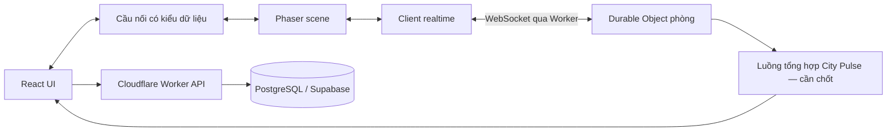

# Thành Phố Không Ngủ — Architecture

Trạng thái: định hướng kiến trúc Phase 0. Chưa khởi tạo ứng dụng, hạ tầng hoặc package.

## 1. Stack định hướng

| Thành phần | Công nghệ | Trách nhiệm |
| --- | --- | --- |
| UI web | React + TypeScript | Màn hình vào game, lựa chọn, HUD, City Pulse, Share Card |
| Game client | Phaser + TypeScript | Scene, hiển thị bản đồ/avatar, input, animation |
| API/biên truy cập | Cloudflare Workers | Xác thực phiên, kiểm tra yêu cầu, định tuyến phòng |
| Realtime | WebSocket + Durable Objects | Trạng thái phòng, thứ tự xử lý, presence, broadcast |
| Dữ liệu bền vững | PostgreSQL/Supabase | Dữ liệu tối thiểu được duyệt, truy cập qua backend |
| Validation | Zod | Kiểm tra schema tại các biên tin cậy |
| Kiểm thử | Vitest + Playwright | Logic/quy tắc và luồng trình duyệt nhiều client |

Không chốt phiên bản, gói bổ sung, nhà cung cấp hosting frontend hoặc phương thức kết nối PostgreSQL ở Phase 0.

## 2. Luồng hệ thống

Sơ đồ mô tả ranh giới logic, chưa quyết định số service hoặc cách triển khai luồng Pulse.

## 3. Quyền sở hữu trạng thái

- React sở hữu UI và lựa chọn đang thao tác; không giữ bản sao độc lập làm nguồn chân lý cho thế giới game.
- Phaser sở hữu vòng đời scene và render; không tự xác thực quyền người chơi hay ghi database.
- Client realtime quản lý kết nối, kiểm tra message nhận, chuyển sự kiện qua cầu nối có kiểu dữ liệu. Khi unmount/đổi scene phải dọn listener và tài nguyên.
- Durable Object của phòng là nguồn chân lý cho vị trí, tư thế, thành viên và tương tác đang diễn ra trong phòng.
- Backend cấp quyền vào phòng, kiểm tra danh mục và quyền truy cập dữ liệu bền vững.
- Database không nằm trên đường ghi từng frame; không ghi vị trí hoặc heartbeat liên tục vào PostgreSQL.

## 4. Phòng và địa điểm

Một địa điểm có thể có nhiều phòng. Định hướng một Durable Object quản lý một phòng để xử lý hành động có thứ tự trong phòng đó.

Sức chứa, chiến lược chọn phòng, cách tạo/đóng phòng và giới hạn tổng tải chưa chốt. MVP không có tương tác xuyên phòng. Không mặc định dùng một Durable Object toàn cục cho toàn bộ người chơi.

Chuyển phòng cần cơ chế bàn giao bảo đảm một hiện diện có hiệu lực: phòng cũ thu hồi hoặc hết lease; phòng mới chỉ nhận với quyền hợp lệ. Nếu thất bại, trả trạng thái rõ và không nhân đôi hiện diện. Chi tiết bàn giao và fencing phải chốt ở Phase 2.

## 5. Đồng bộ và phục hồi

- Client gửi intent, server xác thực rồi phát trạng thái có thứ tự.
- Render có thể nội suy; dự đoán phía client nếu cần phải hòa giải theo server.
- Snapshot đầy đủ là điểm bắt đầu sau join/reconnect; không trông cậy vào phát lại vô hạn.
- Snapshot và cập nhật dùng epoch cùng sequence theo `PROTOCOL.md` để xử lý reset và message cũ.
- Presence có lease/timeout; socket đóng, timeout và thu hồi phiên phải dọn trạng thái.
- Khi Durable Object khởi động lại, không giả định trạng thái bộ nhớ còn nguyên. Cơ chế storage/khôi phục hoặc tái tạo phòng phải được kiểm chứng trước nghiệm thu Phase 2.

## 6. City Pulse

Tổng hợp presence và mood từ các phòng; không quét toàn bộ database mỗi lần UI cập nhật và không cho client báo tổng online.

Cần chốt cơ chế tổng hợp, chu kỳ, TTL, deduplication và xử lý phòng khởi động lại. Ưu tiên cập nhật có room ID, epoch và phiên bản để không cộng trùng dữ liệu cũ. Pulse có thể nhất quán sau một khoảng trễ, với mức trễ được xác định trước Phase 3.

## 7. Dữ liệu và bảo mật

- Dữ liệu tạm thời và dữ liệu bền vững được tách theo `DATABASE.md`.
- Khóa đặc quyền chỉ tồn tại phía backend; frontend không truy cập PostgreSQL trực tiếp.
- Supabase là hướng lựa chọn cho PostgreSQL; không mặc định sử dụng Auth, Storage hay Supabase Realtime. Realtime gameplay dùng WebSocket + Durable Objects.
- Hợp đồng HTTP/WebSocket được kiểm tra runtime bằng Zod. TypeScript không thay thế validation.
- Quyền truy cập, rate limit và kiểm soát lạm dụng theo `SECURITY.md`.

## 8. Kiểm thử và vận hành

Vitest kiểm tra quy tắc trạng thái, schema, cấp quyền và tổng hợp. Playwright kiểm tra desktop/mobile, nhiều client, tương tác và reconnect. Cần kiểm chứng tích hợp thực tế với Worker/Durable Object; mock không đủ xác nhận vòng đời kết nối.

Theo dõi lỗi join, reconnect, disconnect, độ trễ cập nhật, số phòng, bộ nhớ/tải và lỗi dữ liệu tổng hợp. Giá trị ngưỡng, công cụ đo tải, ngân sách và mục tiêu phục hồi chốt theo `ROADMAP.md`.

## 9. Quyết định còn mở

Danh tính/đăng nhập; nhiều tab; hosting frontend; cách kết nối DB và migration; lưu trữ/phục hồi Durable Object; capacity; tick/snapshot rate; chọn/chuyển phòng; tổng hợp Pulse; định dạng Share Card; môi trường deploy và ngân sách.

Các lựa chọn này cần quyết định bằng ghi nhận ngắn gồm bối cảnh, lựa chọn, lý do, tác động và gate nghiệm thu liên quan. Không tự thêm service ngoài stack định hướng.
